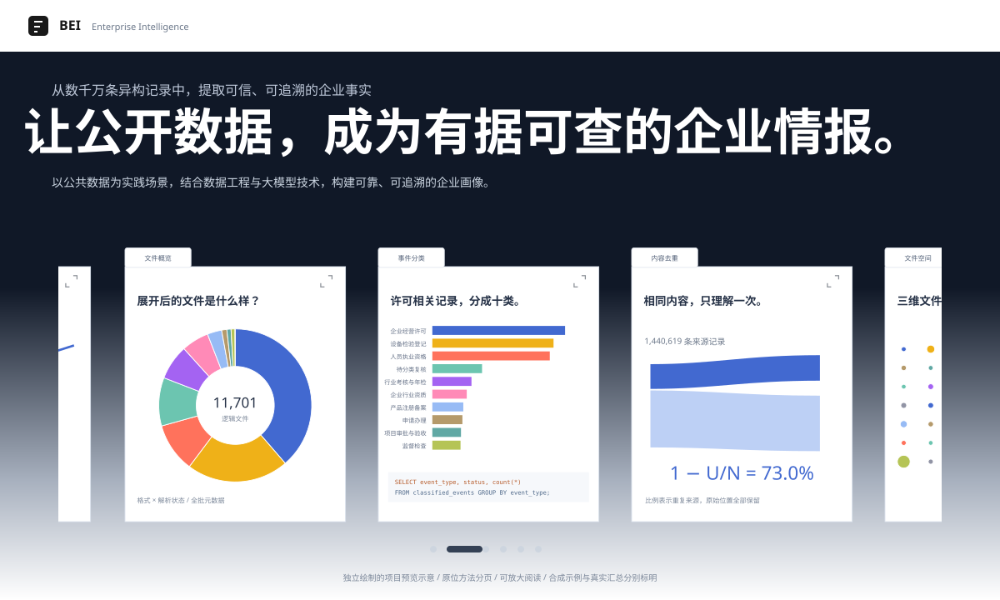

# PublicData-LLM

**Local LLMs for Large-Scale Heterogeneous Public Data**

<p><a href="README.md">简体中文</a> &nbsp; | &nbsp; <strong>English</strong></p>

[](https://chaomacv.github.io/public-data-llm/?lang=en)
[](https://chaomacv.github.io/public-data-llm/?lang=en#lab)

[](https://chaomacv.github.io/public-data-llm/?lang=en)

**[Explore the project page ↗](https://chaomacv.github.io/public-data-llm/?view=compact&lang=en#explorations)** · Nine interactive data notebooks, real source catalogs, acquisition safeguards, a three-mode zoomable sunburst, 2D/3D networks of 100 real company profiles, and a nine-step processing and provenance map. [Final results and file index](docs/full_run_results.md) · [Page design and reproduction](docs/project_page.md)

The batch completed automated processing, classification refinement and final acceptance on **2026-11-10 at 05:56 Beijing time**, with status `COMPLETED_WITH_REVIEW`.

| Batch measure | Count |
| --- | ---: |
| Received original attachments | 5,200 |
| Logical files | 11,701 |
| Known logical records | 43,653,625 |
| Retained records with individual outcomes | 15,861,277 |
| Entity profiles, including provisional identities | 5,202,714 |
| Event observations | 5,968,620 |
| Records requiring review | 6,179,034 |

## From 43.65 million records to 388,349 inference representatives

```text
43,653,625 known logical records
├─ 27,792,348 explicitly excluded; exclusion ledger retained
└─ 15,861,277 retained for processing
   ├─ 14,420,658 field-plan route; executed programmatically per record
   └─  1,440,619 complex semantic source records
      ├─   388,349 distinct content representatives for inference
      └─ 1,052,270 repeated sources, validated before inference reuse
```

After inference, validate and restore outputs to **1,440,619 complex source records**, then combine them with the field-plan route into the **15,861,277-record ledger**. Together with **27,792,348 explicit exclusions**, **all 43,653,625 known records have a recorded destination**. The 388,349 representatives measure semantic-route work; reuse does not delete original records.

The retained ledger comprises mutually exclusive outcomes: EXTRACTED **6,300,941**, NO_EVENT **3,381,302**, and REVIEW **6,179,034**, totaling 15,861,277. Profiles, events and source links use different counting units and cannot be added to record totals.

[Interactive lineage and observed progress](https://chaomacv.github.io/public-data-llm/?view=compact&lang=en#explorations) · [Nine-step inputs, methods, counts and files](docs/data_lineage.md) · [Reconciled data interface](showcase/assets/data-lineage.json)

The network uses **100 real company profiles with checksum-valid credit codes**, selected from the processed results by category and tag richness. Every circle is one anonymized company. Shared category types and corresponding observation counts determine target distances. In the tag view, peripheral category markers connect to companies with those observed tags. Both views support 2D dragging, zooming and 3D rotation.

This is a stratified demonstration sample, not a random population sample. Codes are not verified against an official registry. Events are source observations and may have proposed or unknown stages. Full aggregates, review outputs and tag-combination statistics for all **5,202,714 entity profiles** remain available; original identity mappings and model replies stay on the private server.

The project converts heterogeneous files downloaded from Beijing’s public-data platform into source-backed entities, business events and tag profiles. Local Qwen handles semantic interpretation; Python handles reading, chunking, validation and aggregation.

This is a new post-processing implementation motivated by the business questions in [beijing-open-data-enterprise-risk](https://github.com/chaomacv/beijing-open-data-enterprise-risk). It does not delete or overwrite the original repository or input data, or copy cloud credentials and unrelated screening prompts from older scripts.

## Capabilities

1. Accept a standalone downloader’s work directory or a server-side input directory. Inventory files by content hash and persist processing progress.
2. Detect CSV, Excel, JSON/JSONL and RDF/XML, including Excel content carrying a CSV extension. Read all worksheets.
3. Stream the corpus into file cards containing head/middle/tail and fixed-seed random samples. Build no raw-record fact database before file selection.
4. Prepare complete-record chunks. For local inference, verify input/output budgets with the actual tokenizer and chat template.
5. Use a local model for file selection and declarative field plans. Execute structured mappings per record; group complex content for inference. The small workflow uses SQLite; the full-corpus workflow uses streaming JSONL and DuckDB. Validate quotes, entity indexes and record coverage separately; route unreliable outputs to review.
6. Resolve entities conservatively with credit-code validation, exact names and addresses. Name similarity retrieves review candidates without automatic merging.
7. Export events, tags, profiles, match reasons, review queues and provenance indexes. Retain proposed/confirmed/removed/revoked/unknown stages. Generate no lending score.

Current version: **v0.3.0**. The completed batch used local Qwen3-8B with original BF16 weights, streaming JSONL, field-plan execution, exact-content inference reuse and DuckDB aggregation. [Full-corpus pipeline](docs/full_corpus.md) · [Final results](docs/full_run_results.md) · [Independent evaluation boundaries](docs/validation.md)

All **5,968,620 event observations across 18 categories** are aggregated into profile tags by entity, category and stage; use `classified_profile_tags.parquet`. Categories cover permits, personnel, equipment, products and inspections, as well as penalties, abnormal operations, procurement and innovation. Proposed and unknown stages remain explicit. Classification-review observations stay in profiles but do not contribute to similarity. The page shows a 100-company sample drawn from the full 18-category scope.

Full-corpus entry point; see [deployment and processing](docs/full_corpus.md) for dependencies, model services and system readers. Compatible work directories support resumption. The completed batch does not need rerunning.

```bash
python -m bank_data.bulk_run \
  --input /private/raw --work-dir /private/full_run \
  --model YOUR_LOCAL_MODEL_ID --tokenizer-dir /private/models/Qwen3-8B \
  --endpoints http://127.0.0.1:18080/v1 --workers 6
```

## Installation

Python >=3.10. From the server-side project directory:

```bash
python3.10 -m venv .venv
.venv/bin/python -m pip install -e .
```

File preparation and the rule demo require no GPU, browser, platform login or cloud API.

## Small-sample workflow

Create file cards, then use the local model for selection. Only retained files enter the fact-processing stage. Intermediate results and caches support repeated runs.

```bash
python -m pip install -e '.[llm]'
bank-data workflow --input /private/raw --work-dir /private/results --through scan --workers 4
bank-data workflow --input /private/raw --work-dir /private/results \
  --backend local --endpoint http://127.0.0.1:8000/v1 \
  --model YOUR_LOCAL_MODEL_ID --tokenizer-dir /private/models/Qwen3-8B
```

[Workflow and states](docs/workflow.md) · [Local model service](docs/local_inference.md)

[Method decisions](docs/method_decisions.md) connect actual failure cases, current fixes and conditions for future experiments.

## Run the offline example first

```bash
.venv/bin/bank-data demo --work-dir ../demo_process_work
.venv/bin/python -m pip install -e '.[test]'
.venv/bin/python -m unittest discover -s tests -v
```

The demo generates explicitly labeled synthetic inputs. All company names and business observations are fictional test material. It uses an explicit rule baseline and must not be presented as LLM results or real banking data.

## Prepare real files

```bash
.venv/bin/bank-data prepare \
  --input /opt/data/private/mc/Bank/beijing_download_work \
  --work-dir /opt/data/private/mc/Bank/process_work
```

You can point `--input` to a dedicated data directory such as `/opt/data/private/mc/Bank/data/raw/full-catalog`. The downloader’s browser profile, runtime dependencies, catalog exports and control files are excluded from business extraction. Incomplete `.part/.crdownload` downloads or copies are excluded.

Preparation produces:

- `inventory.json`: file content hashes, formats and states.
- `state.sqlite`: original locations, values, worksheets and caches.
- `file_cards.jsonl`: summaries for model-based file selection.
- `prepared_chunks.jsonl`: complete-record preparation chunks.
- `prepare_summary.json`: preparation results and parsing failures.

A parsing failure isolates the whole file; a partially read file is not accepted as success. Original files remain read-only, and the work directory must be outside the input directory.

## Use local Qwen

Follow [deployment instructions](docs/local_inference.md) to install CUDA-enabled PyTorch and `.[serve]` in a separate inference environment. Keep weights outside the repository. Bind the service to `127.0.0.1:8000`; do not automatically upgrade system drivers.

```bash
python -m bank_data.serve --model-dir /private/models/Qwen3-8B \
  --model-id qwen3-8b-checkpoint-v1 --device cuda:0 --port 8000
```

Run in a second terminal:

```bash
bank-data workflow \
  --input /opt/data/private/mc/Bank/data/raw/full-catalog \
  --work-dir /opt/data/private/mc/Bank/process_work \
  --backend local \
  --endpoint http://127.0.0.1:8000/v1 \
  --model qwen3-8b-checkpoint-v1 \
  --tokenizer-dir /path/to/local/Qwen3-8B
```

Tokenizers and weights are read locally; no remote code is downloaded. The client permits only loopback/RFC1918 endpoints, disables proxies and redirects, and has no cloud fallback. The bundled service constrains output with JSON Schema and disables thinking mode. Format constraints do not guarantee semantic correctness.

Explicitly select the rule baseline when needed:

```bash
.venv/bin/bank-data run --input /path/to/data --work-dir /path/to/private_work --backend rules
```

## Outputs and validation

The JSON/SQLite files below belong to the small-sample workflow. For full-corpus JSONL, Parquet, DuckDB and corrected classifications, see [final results and file index](docs/full_run_results.md).

`record_results.json` records an outcome for every parsed record. `FILE_EXCLUDED`, `REVIEW` and `NO_EVENT` are distinct. State-coverage checks in `run_summary.json` establish ledger completeness, not 100% semantic recall.

`source_index.json` links outputs to original files, worksheets and logical-record positions. Evidence must come from specified cells or a validated original `__filename__` title. An event links through a subject index to a validated name reference in the same record. Files, model configuration, ontology and prompt changes affect cache keys. Change the service model name when replacing weights. Source-manifest changes trigger preparation; failed compatibility checks isolate old records.

`entities.json`, `entity_mentions.json` and `match_decisions.json` retain provenance and match reasons. Conflicting reliable credit codes are not merged. Same-name records without addresses remain separate, with candidates for review. A valid code structure and checksum are not authoritative company-registry verification.

## Current boundaries

- File sampling can miss rare events. Excluded files still need independent sampling and labeled evaluation.
- Multi-row headers use inspectable heuristics. Excel readers consume cached cell values; complex subtables, formula caches and footnotes need checks. The full pipeline reads documents, necessary OCR, archives, XML and geodatabase attributes; 65 unreliable logical files in this batch remain separate review items.
- File scanning uses a fixed number of samples. Partitioned JSONL and disk-based DuckDB aggregation support the full batch, but larger scales require fresh resource and quality checks.
- Complex requests are split against actual token budgets; long text may use overlapping positioned segments and merging. Unreliable single records remain in review.
- Without a reliable event identifier, preserve distinct source observations conservatively. Semantic similarity alone is not duplication. Automatic cross-stage event linkage is not implemented.
- Real 100-company similarity and peripheral-tag views are implemented. Vector retrieval, probabilistic identity matching, a human-review workbench and reversible entity merging remain future work.
- No training/validation dataset is available; the project reports neither measured accuracy nor banking returns.

## Keep data separate from code

Do not commit source data, processing outputs, model weights, browser profiles or credentials. Suggested server layout:

```text
Bank/
  public-data-llm/   # Source, configuration, documentation and tests
  beijing_download_work/            # Original downloader work directory
  data/raw/                        # Original files
  models/                          # Local weights
  process_work/                    # Private processing outputs
```

See [the data contract](docs/data_contract.md). Technical documents retain their original Chinese text; the project page and this README have dedicated English views. Original source names, fields, paths and evidence retain their source language.
