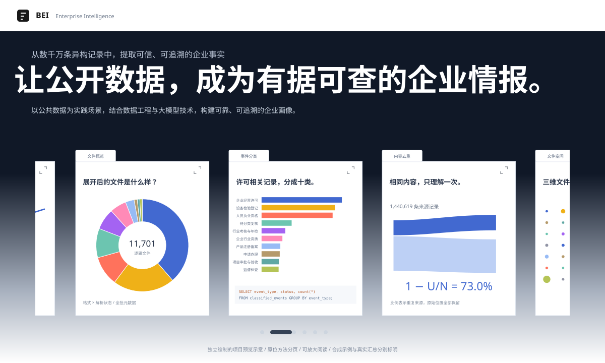

# Beijing Enterprise Intelligence

[](https://chaomacv.github.io/beijing-enterprise-intelligence/)
[](https://chaomacv.github.io/beijing-enterprise-intelligence/#lab)

[](https://chaomacv.github.io/beijing-enterprise-intelligence/)

**[探索 Project Page ↗](https://chaomacv.github.io/beijing-enterprise-intelligence/)** · 九步流程、方法实验与证据追溯。交互案例使用合成数据；真实运行汇总与工程对照单独标明，全量抽取仍在进行中。[页面设计与复现](docs/project_page.md)

把北京公共数据平台下载的异构文件，转换为有来源证据的企业记录、业务事件与标签画像。语义理解使用私有环境中的 Qwen；读取、分块、校验和聚合使用 Python。

这是从 [beijing-open-data-enterprise-risk](https://github.com/chaomacv/beijing-open-data-enterprise-risk) 的业务问题出发建立的新后处理工程。原仓库和原始数据不做删除或覆盖。本项目重新实现处理模块，不复制旧脚本中的云 API 凭据或非企业筛选提示词。

## 当前版本能做什么

1. 接收独立下载器的工作目录，或服务器上的原始文件目录；按内容哈希盘点并保存处理状态。
2. 识别 CSV、Excel、JSON/JSONL、RDF/XML。识别“扩展名是 CSV、实际是 Excel”的文件，读取全部工作表。
3. 流式扫描全目录，生成首/中/尾与固定种子随机样本的文件卡片；筛选前不建立原始记录事实库。
4. 生成按完整记录划分的准备块；使用本地模型时，再以实际 tokenizer 和聊天模板检查输入/输出预算。
5. 用本地模型筛选文件；保留文件的完整记录进入 SQLite，再逐块抽取主体和事件。验证原文引用、主体索引与逐条 ID 覆盖；截断或验证失败时递归缩小批次，单条仍失败则进入复核。
6. 使用信用代码校验、名称和地址做保守实体关联；名称相似只生成复核候选，不直接合并。
7. 导出事实事件、标签、画像、匹配依据、复核队列和来源索引。保留 proposed/confirmed/removed/revoked/unknown 状态，不生成授信评分。

当前版本 **v0.2**。已校验接收 5,200 个附件，完成全量文件卡片扫描；Qwen3-8B 已在私有 RTX 4090 上运行并完成小样本端到端验证。**全量 LLM 抽取和独立准确率评测尚未完成。** [实测范围与结果](docs/validation.md) · [GitHub 交付记录](https://github.com/chaomacv/beijing-enterprise-intelligence/pull/2)

全量扩展开发见 [PR #5](https://github.com/chaomacv/beijing-enterprise-intelligence/pull/5) 与 [全量流程及中间产物](docs/full_corpus.md)。本批已固定 5,200 份附件、展开 11,701 个逻辑文件，完成筛选、字段规划和完整记录准备；复杂内容推理、来源回填及最终对账仍在运行。公开页面的更新在合并后部署。

## 安装

Python >=3.10。在服务器项目目录执行：

```bash
python3.10 -m venv .venv
.venv/bin/python -m pip install -e .
```

文件准备和规则 Demo 不需要 GPU、浏览器、平台登录或云 API。

## v0.2 完整流程入口

先生成文件卡片，再由本地模型筛选；只有保留文件的记录进入事实库。阶段结果与缓存支持重复运行。

```bash
python -m pip install -e '.[llm]'
bank-data workflow --input /private/raw --work-dir /private/results --through scan --workers 4
bank-data workflow --input /private/raw --work-dir /private/results \
  --backend local --endpoint http://127.0.0.1:8000/v1 \
  --model YOUR_LOCAL_MODEL_ID --tokenizer-dir /private/models/Qwen3-8B
```

[完整流程与状态说明](docs/workflow.md) · [本地模型服务与部署](docs/local_inference.md)

[为什么这样选工具和方法](docs/method_decisions.md) 将真实失败、当前修正和后续实验的触发条件放在一起。

## 先运行离线闭环

```bash
.venv/bin/bank-data demo --work-dir ../demo_process_work
.venv/bin/python -m pip install -e '.[test]'
.venv/bin/python -m unittest discover -s tests -v
```

Demo 输入由代码生成并明确标注为合成示例，所有企业名称和业务事实都是虚构的测试素材。`demo` 使用显式的规则基线，不能冒充 LLM 结果或银行实际业务数据。

## 准备真实文件

```bash
.venv/bin/bank-data prepare \
  --input /opt/data/private/mc/Bank/beijing_download_work \
  --work-dir /opt/data/private/mc/Bank/process_work
```

也可以把 `--input` 指向 `/opt/data/private/mc/Bank/data/raw/full-catalog` 等专门的数据目录。下载器的浏览器目录、运行依赖、目录导出和控制文件不参与业务抽取。下载或复制尚未结束的 `.part/.crdownload` 文件被排除。

`prepare` 输出：

- `inventory.json`：每个文件的内容哈希、格式与状态。
- `state.sqlite`：原始位置、原值、工作表和缓存。
- `file_cards.jsonl`：模型筛选所需的文件摘要。
- `prepared_chunks.jsonl`：按记录划分的准备块。
- `prepare_summary.json`：准备结果及解析失败统计。

解析失败会隔离整个文件，不把“读到一半”记作成功。原始文件保持只读。工作目录必须在输入目录之外。

## 使用本地 Qwen

先按 [部署说明](docs/local_inference.md) 在独立推理环境安装 CUDA 版 PyTorch 和 `.[serve]`，模型权重放在仓库外。服务绑定本机 `127.0.0.1:8000`，不自动升级系统驱动。

```bash
python -m bank_data.serve --model-dir /private/models/Qwen3-8B \
  --model-id qwen3-8b-checkpoint-v1 --device cuda:0 --port 8000
```

在另一个终端运行：

```bash
bank-data workflow \
  --input /opt/data/private/mc/Bank/data/raw/full-catalog \
  --work-dir /opt/data/private/mc/Bank/process_work \
  --backend local \
  --endpoint http://127.0.0.1:8000/v1 \
  --model qwen3-8b-checkpoint-v1 \
  --tokenizer-dir /path/to/local/Qwen3-8B
```

tokenizer 和权重只从本地读取，不下载远程代码。客户端只允许 loopback/RFC1918 地址，禁用代理及重定向，没有云 API 回退。内置服务通过 JSON Schema 约束输出并关闭思考模式；格式约束不保证语义正确。

明确选择规则对照：

```bash
.venv/bin/bank-data run --input /path/to/data --work-dir /path/to/private_work --backend rules
```

## 最终输出与核验

`record_results.json` 给每条已解析记录一个处理结果；`FILE_EXCLUDED`、`REVIEW` 和 `NO_EVENT` 含义不同。`run_summary.json` 的状态覆盖检查只说明台账完整，不代表语义召回率为 100%。

`source_index.json` 将结果关联回原文件、工作表和逻辑记录序号。事件证据必须来自指定单元格，或受校验的 `__filename__` 原始标题；事件通过主体下标关联本行已校验的名称引用。文件、模型配置、本体和提示词变化会影响缓存键；更换权重时使用新的服务模型名。来源清单变化会重新准备文件，校验失败则隔离旧记录。

`entities.json`、`entity_mentions.json`、`match_decisions.json` 保留实体来源和匹配理由。不同且可信的信用代码不会自动合并；同名无地址的记录保留独立主体和候选。信用代码校验只证明形式/校验位正确，不等于权威工商身份核验。

## 当前边界

- 文件抽样不能保证发现罕见事件；排除文件仍需独立抽查与标注评估。
- 多行表头采用可检查的启发式。Excel 读取单元格缓存值，复杂子表、公式缓存和脚注语义需要抽查；PDF/OCR、压缩包及超大普通 JSON 显式进入复核，不能宣称已支持所有文件。
- 文件扫描使用固定数量的行样本；提取结果聚合与实体匹配仍在内存中进行。亿级数据需要后续分区、SQL 聚合和独立评测。
- 超长单条记录目前进入复核；跨段重叠与 fragment 级合并是下一阶段工作。
- 没有可靠事件编号时保守保留不同源事件，不把语义相似直接当成重复。尚未实现跨事件阶段的自动关联。
- 向量召回、概率匹配、关系图、人工复核界面、实体撤销合并等属于下一阶段，不作为本轮已交付能力。
- 没有训练/验证集，因此不报告准确率、性能提升或银行收益。

## 数据与代码分离

原始数据、处理结果、模型权重、浏览器资料与凭据均不提交 Git。建议服务器布局：

```text
Bank/
  beijing-enterprise-intelligence/   # 仅源码、配置、文档、测试
  beijing_download_work/            # 原下载工作目录
  data/raw/                        # 原始文件
  models/                          # 本地权重
  process_work/                    # 私有处理结果
```

详细契约见 [docs/data_contract.md](docs/data_contract.md)。
